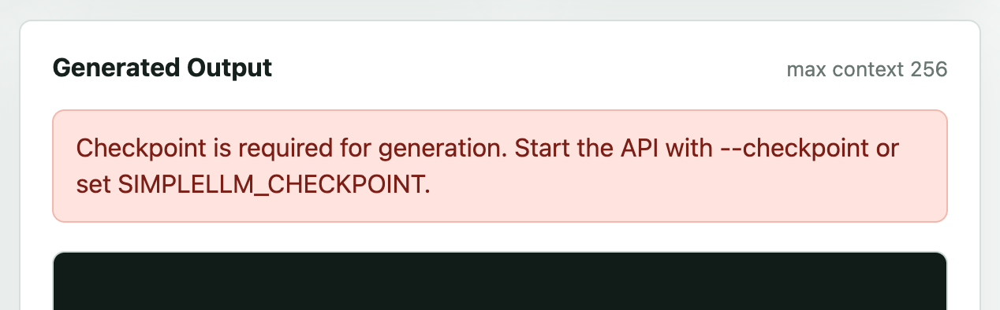
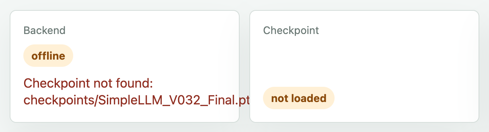
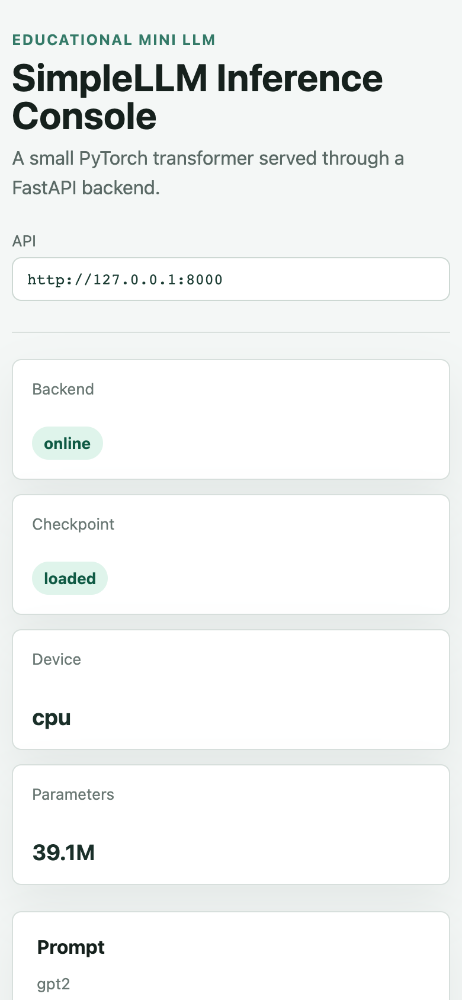
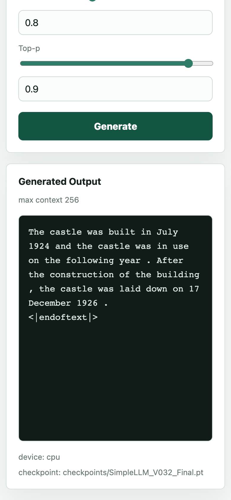
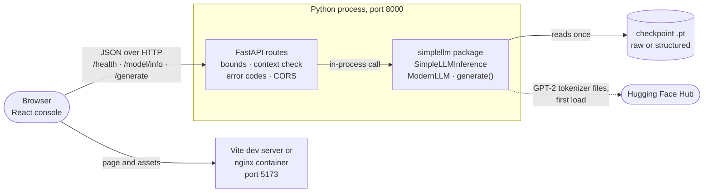
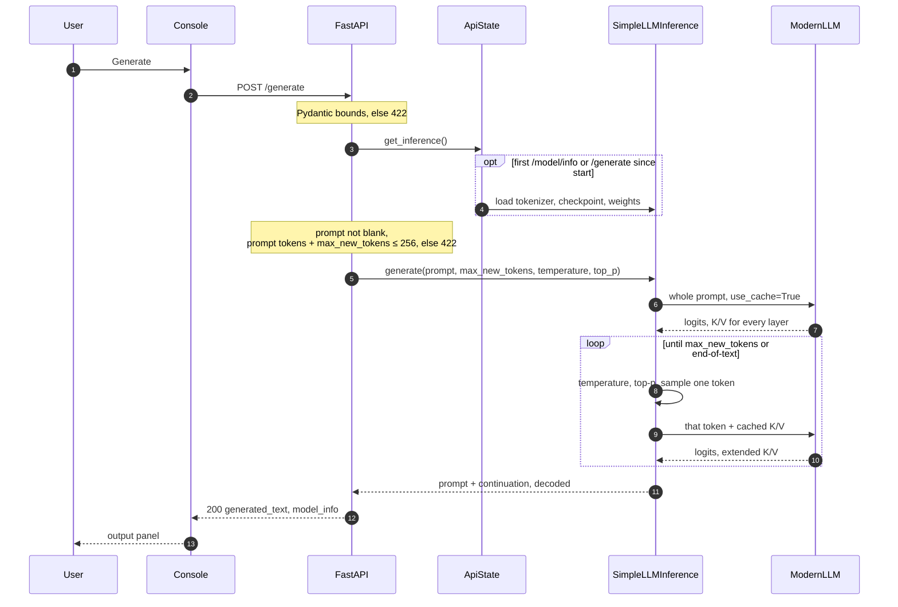
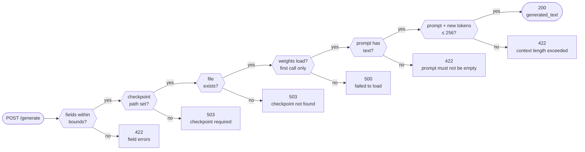
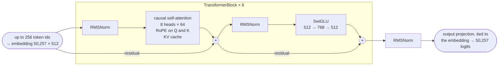
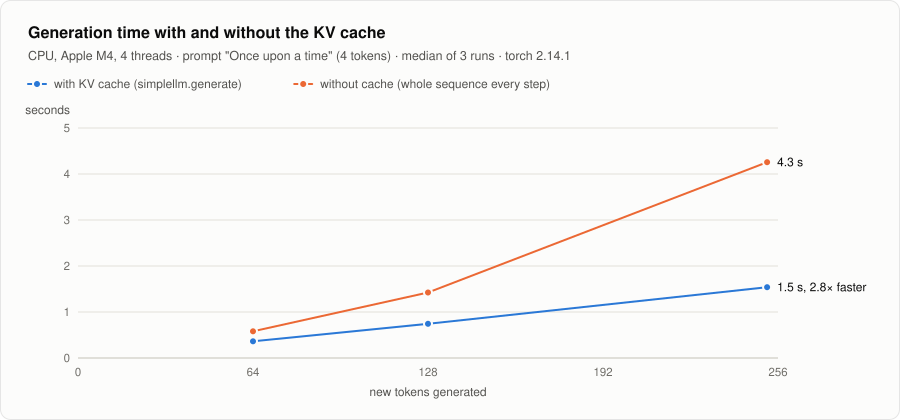

# Mini LLM

Mini LLM is a 39.1M-parameter language model written from scratch in PyTorch, together with the parts it needs to be used rather than only trained: an importable package, a FastAPI service, a React console, tests and Docker Compose. You type a prompt, set the number of new tokens, the temperature and top-p, and the model continues the text in the browser. Underneath is a LLaMA-style decoder: RMSNorm, rotary position embeddings, SwiGLU, causal attention through PyTorch's `scaled_dot_product_attention`, a KV cache, and the GPT-2 tokenizer.

The project started as a training notebook and was refactored to show how the pieces of a language-model application fit together: which requests the API should refuse before it spends compute, how checkpoints from the notebook keep loading after the refactor, and what the UI says when the backend or the weights are missing. It is an educational model. Its output reads like Wikipedia with the meaning taken out, which is what 39M parameters trained on WikiText-103 produce, and every sample on this page names the weights and settings behind it.

[](pyproject.toml)
[](requirements.txt)
[](src/simplellm/api/main.py)
[](frontend/package.json)
[](docker-compose.yml)


[Training notebook](archive/SimpleLLM_V_032_PyTorch.ipynb) · [Model](src/simplellm/model.py) · [Sampling loop](src/simplellm/generation.py) · [API routes](src/simplellm/api/main.py) · [Tests](tests/)

## What the code guarantees

Each row is a property the code enforces, the mechanism that enforces it, and the test or measurement that checks it.

| Guarantee | Mechanism | Evidence |
| --- | --- | --- |
| A checkpoint saved by the original notebook loads into the package unchanged | The package keeps the notebook's module and parameter names; `load_checkpoint` recognises a bare `state_dict` and loads it with `strict=True` | Run for this README: the notebook's own `ModernLLM` (cells 2 and 4–6) saved a `state_dict`, the package loaded it strictly, and both models returned identical logits (largest difference 0.0). `SimpleLLM_V032_Final.pt` itself: 58 tensors, no missing or unexpected keys. Unit test: [`test_checkpoint.py:35`](tests/test_checkpoint.py#L35) |
| A request that cannot fit the 256-token context is refused before the model runs | The API tokenizes the prompt and checks that prompt tokens plus `max_new_tokens` stay within `max_seq_len`; otherwise 422 with the reason | [`main.py:175`](src/simplellm/api/main.py#L175), [`test_api.py:117`](tests/test_api.py#L117), and the second animation below |
| Out-of-range sampling settings never reach the sampler | Pydantic bounds (`max_new_tokens` 1–256, `temperature` in (0, 5], `top_p` in (0, 1]); for callers that skip the API, `generate()` itself rejects a temperature of 0 or below and a `top_p` outside (0, 1] | [`schemas.py:23`](src/simplellm/api/schemas.py#L23), [`generation.py:47`](src/simplellm/generation.py#L47), [`test_api.py:94`](tests/test_api.py#L94) |
| Generation never indexes past the rotary-embedding table | `generate()` keeps only the last `max_seq_len` prompt tokens and caps the number of steps at the positions left in the table | [`generation.py:58`](src/simplellm/generation.py#L58), [`test_generation.py:53`](tests/test_generation.py#L53) |
| Without weights the service still starts and says how to fix it | `/health` and `/model/info` never require a checkpoint; `/generate` answers 503 and names `--checkpoint` and `SIMPLELLM_CHECKPOINT` | [`main.py:58`](src/simplellm/api/main.py#L58), [`test_api.py:129`](tests/test_api.py#L129), and the screenshots below |
| Each new token costs one position, not the whole sequence | Every attention layer returns its keys and values; each later step feeds only the new token plus that cache | [`model.py:85`](src/simplellm/model.py#L85), [`test_model.py:27`](tests/test_model.py#L27); measured: 2.8× faster than recomputing at 252 new tokens on CPU ([Inference speed](#inference-speed)) |
| The model is loaded once, on first use, and load failures become HTTP errors | `ApiState.get_inference()` builds `SimpleLLMInference` lazily and keeps it; a missing file is 503, an unreadable one 500 | [`main.py:54`](src/simplellm/api/main.py#L54); measured: first `/model/info` 1.7–2.1 s, later calls under 1 ms |

The repository has 14 tests in four files. They pass on CPU in under a second (0.58 s on an M4) with no checkpoint and no network, which was checked for this README with `HF_HUB_OFFLINE=1` and an empty Hugging Face cache: the API tests inject a fake inference service, and the model tests use a 32-dimension configuration. There is no CI yet.

## Product tour

The animations and screenshots come from a local run on 20 October 2026: the API on CPU with `SimpleLLM_V032_Final.pt`, the console on the Vite dev server, captured in headless Chrome on an Apple M4. The model was already loaded when each recording started. Both animations replay real requests at recorded speed: the recording script draws the pointer and types at a fixed pace, and each wait for the model lasts as long as the measured round trip. Each is the first take.

### One request, end to end

The animation at the top replaces the prompt with "The castle was built in", raises the token budget to 80 and lowers the temperature to 0.6. The status cards were filled when the page loaded, by `GET /health` and `GET /model/info`. Generate sends `POST /generate`. The server runs the prompt through the model once, then produces one token at a time from the KV cache, and returns the prompt followed by the continuation. This request used all 80 tokens and took 886 ms from click to text. The repetition, "designed by John M. Williams" three times, is typical of a model this size at a low temperature.

### What the sampling controls do

The same prompt with seed 0, top-p 0.9 and 40 new tokens, through `SimpleLLMInference.generate()`, the call the API makes:

| Temperature | Output (prompt in bold) |
| --- | --- |
| 0.3 | **The castle was built in** 1891 and the castle was built in 1891 . The castle was built in 1891 and was built in 1891 . The castle was built in 1891 and was completed in 1891 . |
| 0.8 | **The castle was built in** 1809 by Prince Charles of France . The castle was finished in 1812 . In 1849 the English government made the castle in the hands of the Lord of the order . The castle was sold for |
| 1.5 | **The castle was built in** began by Streetswood planningwriters independent French Robertson Sopobby brunt competition chain Wol daylight Ips gyrog correlation punk , where External puzzles upwards Chris Ministeruga Cricket came and Chrisothe Review by Lind assassins &lt;unk |

Temperature divides the logits before the softmax. Below 1 the distribution sharpens and the text loops; above 1 it flattens and rare tokens win. Top-p then keeps the smallest set of tokens whose probabilities add up to `top_p` and samples from that set ([`generation.py:72`](src/simplellm/generation.py#L72)). The spaced punctuation and `<unk>` come from WikiText-103, which writes text that way.

### The context guard


"Once upon a time" is 4 tokens. Asking for 256 more needs 260 positions in a 256-token context, so the API answers 422 before the model runs, and the console shows FastAPI's message as it arrived. The refusal took 86 ms. With 120 tokens the same prompt fits; the model ended its paragraph after 51 tokens, and the literal `<|endoftext|>` at the end shows how it stopped.

### When something is missing

| No checkpoint configured | Checkpoint path set, file missing |
| --- | --- |
|  |  |

The two cases look alike and behave differently. With no path at all, the API serves `/health` and `/model/info`, the console shows the backend online, and only `/generate` fails, with a message that names the fix. With a path that points nowhere, `/model/info` fails too. The console loads `/health` and `/model/info` together and treats either failure as an outage ([`App.jsx:32`](frontend/src/App.jsx#L32)), so it reports the backend as offline and disables Generate. This second case is what Docker Compose produces when `checkpoints/` is empty, because the compose file always sets `SIMPLELLM_CHECKPOINT`. With the API stopped, the console looks the same, with "Failed to fetch" as the message.

### On a phone

<table>
  <tr>
    <td align="center"></td>
    <td align="center"></td>
  </tr>
  <tr>
    <td align="center">At phone width the status cards stack</td>
    <td align="center">A 60-token request; the model stopped after one sentence</td>
  </tr>
</table>

## Architecture

The browser loads the console from Vite in development or nginx in Docker, then talks to the API directly. The API and the model run in one Python process: FastAPI handles HTTP, validation and error codes, and calls the `simplellm` package in-process.



| Layer | Owns | Talks to | Port |
| --- | --- | --- | --- |
| [Console](frontend/src/App.jsx) | prompt form, sampling controls, status cards, error display | the API, with `fetch` ([`api.js`](frontend/src/api.js)) | 5173 |
| [API](src/simplellm/api/main.py) | routes, request bounds, context check, HTTP error mapping, CORS, lazy model loading | the engine, in-process | 8000 |
| [Engine](src/simplellm/) | model, tokenizer, sampling, checkpoint formats | the checkpoint file; the Hugging Face Hub for the tokenizer on first load | none |

The layers stay separate on purpose. The console never imports model code, the API holds no generation logic, and the engine can be tested without HTTP or a browser.

### One request through the stack



### Every way `/generate` can answer



## Model

| Component | Implementation | Code |
| --- | --- | --- |
| Tokenizer | GPT-2 byte-level BPE, 50,257 tokens; end-of-text doubles as padding | [`tokenizer.py`](src/simplellm/tokenizer.py) |
| Embedding | 50,257 × 512, the same matrix as the output projection | [`model.py:134`](src/simplellm/model.py#L134) |
| Blocks | 6 pre-norm blocks: attention, then SwiGLU, each wrapped in a residual connection | [`model.py:104`](src/simplellm/model.py#L104) |
| Attention | 8 heads of 64 dimensions, no biases, causal `scaled_dot_product_attention`, dropout 0.1 on the output | [`model.py:58`](src/simplellm/model.py#L58) |
| Positions | rotary embeddings on queries and keys, precomputed for 512 positions, twice the context | [`model.py:24`](src/simplellm/model.py#L24) |
| Feed-forward | SwiGLU, 512 → 768 → 512 | [`model.py:44`](src/simplellm/model.py#L44) |
| Normalization | RMSNorm, ε = 1e-5 | [`model.py:12`](src/simplellm/model.py#L12) |
| Context | 256 tokens | [`config.py:19`](src/simplellm/config.py#L19) |
| Sampling | temperature, then top-p over the sorted distribution; stops at end-of-text | [`generation.py:72`](src/simplellm/generation.py#L72) |
| Inference cache | keys and values per layer, extended by one position per step | [`model.py:85`](src/simplellm/model.py#L85) |



Two-thirds of the parameters are the vocabulary embedding. Counted from the instantiated default model:

| Part | Parameters | Share |
| --- | ---: | ---: |
| Token embedding, shared with the output layer | 25,731,584 | 65.8% |
| Feed-forward (SwiGLU), 6 layers | 7,077,888 | 18.1% |
| Attention projections, 6 layers | 6,291,456 | 16.1% |
| RMSNorm weights | 6,656 | 0.02% |
| **Total** | **39,107,584** | |

Without weight tying the same model would have 64,839,168 parameters.

## Training

The training loop lives in the notebook, cells 3 and 8. It streams WikiText-103, tokenizes each non-empty line, appends an end-of-text token, and packs the stream into 257-token windows that give 256 inputs and 256 shifted targets. Every 500 steps it measures validation loss on the first 10 validation batches and prints a 40-token sample for "Once upon a time". It is set up for 20,000 steps on a CUDA GPU with fp16 autocast, and it writes `SimpleLLM_V032_Final.pt` when it finishes. That file is the checkpoint used throughout this page. It is a bare `state_dict`, so it carries no step count or training log of its own.

| Setting | Value |
| --- | --- |
| Batch | 32 sequences × 256 tokens = 8,192 tokens per step; 20,000 steps is 164M tokens |
| Optimizer | AdamW, β = (0.9, 0.95), weight decay 0.05 |
| Learning rate | 5e-4 peak, linear warmup over 1,000 steps, cosine decay to 0 (`min_lr` is defined but unused) |
| Gradient clipping | 1.0 |
| Dropout | 0.1, on the attention output |
| Precision | fp16 autocast; the gradient scaler is enabled on CUDA only |
| Data | WikiText-103 `train`, in file order, no shuffling |

### What training buys

Validation loss is the measurement the notebook prints during training: cross-entropy over the first 10 validation batches, 81,920 tokens. A model that guessed uniformly over 50,257 tokens would score ln 50,257 = 10.83.

| Weights | Validation loss | Perplexity | Sample after "Once upon a time", temperature 0.8, top-p 0.9 |
| --- | ---: | ---: | --- |
| Untrained, the notebook's initialisation | 10.92 | 55,410 | **Once upon a time**text startledFINEpeace Fen wild Dise,- horrific Rampage Spr defbit DeterWhatever Samberman … |
| After 500 steps | 6.00 | 404 | **Once upon a time** year @-@ 4 was also ) , and on the area of the West – 1 @,@ 22 plan in 5 % years . In his first @-@ 0 @-@ 5080 |
| `SimpleLLM_V032_Final.pt` | 3.64 | 38.1 | **Once upon a time** of 16 minutes , and by the time of the day he had been awarded the prize . |

The 500-step row comes from re-running the notebook's recipe on an Apple M4 for this README. That run was stopped at step 800, so its last evaluation is the one at step 500, and the training loop drew that sample with seed 500; the other two use seed 0. At 500 steps the model has already picked up WikiText's habit of writing hyphens and thousands separators as ` @-@ ` and ` @,@ `, but not yet how to finish a sentence.

## Inference speed

<picture>
  <source media="(prefers-color-scheme: dark)" srcset="docs/charts/kv-cache-dark.svg">
  
</picture>

Without the cache, step k runs the model over all 4 + k tokens again, so the total work grows with the square of the length. With it, each step processes one token against the stored keys and values. On the M4's CPU (PyTorch used 4 threads), the cache makes 64 new tokens 1.6× faster and 252 tokens 2.8× faster, at a steady 164–176 tokens per second. The gap is smaller than a quadratic cost suggests at these lengths: one forward pass over a few hundred tokens is a large matrix multiplication, which the CPU runs far more efficiently per token than the single-token passes the cache leaves. Through the console, the 80-token request at the top of this page took 886 ms from click to text, HTTP and rendering included.

<details>
<summary>All benchmark runs</summary>

Median of three runs per cell, prompt "Once upon a time", end-of-text disabled so every run produces exactly the requested number of tokens. "Without cache" is the same sampling loop, re-running the model over the whole sequence at every step. Timing does not depend on the weight values, so the benchmark used an untrained model of the same shape. Python 3.11, torch 2.14.1.

| New tokens | With cache | Without cache | Speed-up | Tokens/s with cache |
| ---: | ---: | ---: | ---: | ---: |
| 64 | 0.36 s | 0.58 s | 1.6× | 176 |
| 128 | 0.74 s | 1.42 s | 1.9× | 172 |
| 252 | 1.54 s | 4.26 s | 2.8× | 164 |

</details>

## Engineering highlights

| Problem | Decision | Code |
| --- | --- | --- |
| The notebook saved bare `state_dict` files with no config | Keep the notebook's parameter names and accept both formats; new checkpoints also carry the config, tokenizer name and step | [`checkpoint.py:95`](src/simplellm/checkpoint.py#L95), [`inference.py:40`](src/simplellm/inference.py#L40) |
| Loading the model takes seconds and can fail, but the service should still start | Build the inference object on first use and keep it; missing and broken files become 503 and 500 | [`main.py:54`](src/simplellm/api/main.py#L54) |
| A long prompt could run past the rotary table | Clamp inside `generate()`, and let the API reject earlier with a message that says why | [`generation.py:58`](src/simplellm/generation.py#L58), [`main.py:169`](src/simplellm/api/main.py#L169) |
| Tests should not need 157 MB of weights or a tokenizer download | `create_app()` accepts an `inference_service`; the tests pass a fake one | [`main.py:185`](src/simplellm/api/main.py#L185), [`test_api.py:13`](tests/test_api.py#L13) |
| Re-running the whole sequence for every new token grows quadratically | A per-layer key/value cache; after the prompt, only the newest token goes through the model | [`model.py:85`](src/simplellm/model.py#L85), [`generation.py:89`](src/simplellm/generation.py#L89) |
| The console and the API run on different origins | A CORS allowlist from `SIMPLELLM_CORS_ORIGINS`, GET and POST only, no credentials | [`main.py:32`](src/simplellm/api/main.py#L32), [`main.py:207`](src/simplellm/api/main.py#L207) |
| Weights do not belong in git | `*.pt` is ignored; Compose mounts `./checkpoints` read-only at `/models` | [`.gitignore:41`](.gitignore#L41), [`docker-compose.yml:10`](docker-compose.yml#L10) |

## API

| Method | Path | Returns |
| --- | --- | --- |
| `GET` | `/health` | `{"status": "ok"}`; never touches the model |
| `GET` | `/model/info` | model type, device, whether a checkpoint is loaded, parameter count, `max_seq_len`, tokenizer; loads the model on the first call |
| `POST` | `/generate` | `generated_text` (the prompt followed by the continuation) and `model_info` (device, checkpoint path) |
| `GET` | `/docs` | Swagger UI generated by FastAPI, with a form for every route |

`POST /generate` takes `prompt` (required, not blank), `max_new_tokens` (1–256, default 50), `temperature` (above 0, at most 5, default 0.8) and `top_p` (above 0, at most 1, default 0.9).

```bash
curl -s http://127.0.0.1:8000/generate \
  -H 'Content-Type: application/json' \
  -d '{"prompt": "The castle was built in", "max_new_tokens": 30}'
```

```json
{
  "generated_text": "The castle was built in the early 19th century , in a history of the use of massive , architectural architecture to build the castle . The building was built as a part of",
  "model_info": {
    "device": "cpu",
    "checkpoint": "checkpoints/SimpleLLM_V032_Final.pt"
  }
}
```

<details>
<summary>Error responses</summary>

| Status | When | `detail` |
| --- | --- | --- |
| 422 | a field is outside its bounds | FastAPI's field errors; the console joins them as `body.top_p: Input should be less than or equal to 1` |
| 422 | the prompt is blank | `prompt must not be empty` |
| 422 | prompt tokens + `max_new_tokens` > 256 | `context length exceeded: prompt tokens plus max_new_tokens must be <= 256` |
| 503 | no checkpoint path was given | `Checkpoint is required for generation. Start the API with --checkpoint or set SIMPLELLM_CHECKPOINT.` |
| 503 | the path does not exist; also returned by `/model/info` | `Checkpoint not found: <path>` |
| 500 | the file exists but does not load | `Failed to load model checkpoint: <error>` |

</details>

## Run locally

Requirements: Python 3.10 or later, Node.js 20.19 or later (Vite 7 requires it), and Docker with Compose v2 if you want the containers.

> [!IMPORTANT]
> No weights ship with the repository; `*.pt` is gitignored. To generate text you need a checkpoint: train one with the notebook (cell 8 writes `SimpleLLM_V032_Final.pt`) or use one you already have. Without one, the API and the console still start, but `/generate` answers 503, and under Docker Compose the console reports the backend offline (see [When something is missing](#when-something-is-missing)).

The checkpoint used on this page is 156,584,939 bytes with SHA-256 `3e88376a1a521c2fc6ce8c7fbae979dea135fa0ed611a2d5be84f6a7f7f7668d`. A 0-byte `.pt` file is usually a cloud-storage placeholder (OneDrive, iCloud) that was copied before it was downloaded.

```bash
git clone https://github.com/Adwerse/Mini_LLM && cd Mini_LLM
python -m venv .venv && source .venv/bin/activate
pip install -r requirements.txt
python scripts/serve.py --checkpoint checkpoints/SimpleLLM_V032_Final.pt --device cpu   # API on http://127.0.0.1:8000
```

In a second terminal:

```bash
cd frontend && npm install && npm run dev      # console on http://localhost:5173
```

Open the console at `localhost`, as Vite prints it. Vite listens on whatever `localhost` resolves to, and on macOS that is the IPv6 address `::1`, so `http://127.0.0.1:5173` refuses the connection during development. The Docker setup publishes port 5173 on all interfaces, so either address works there.

With Docker, put the checkpoint at exactly `checkpoints/SimpleLLM_V032_Final.pt`; the compose file mounts the folder read-only and points the backend at that name.

```bash
docker compose up --build      # console http://127.0.0.1:5173, API http://127.0.0.1:8000
```

| URL | What it is |
| --- | --- |
| http://localhost:5173 | the console (Vite dev server; nginx in Docker) |
| http://127.0.0.1:8000/docs | Swagger UI, generated by FastAPI; every route can be tried from the browser |
| http://127.0.0.1:8000/health | liveness only; answers without loading the model |
| http://127.0.0.1:8000/model/info | what is loaded, on which device; the first call loads the checkpoint |

| Variable | Read by | Purpose |
| --- | --- | --- |
| `SIMPLELLM_CHECKPOINT` | `scripts/serve.py` (default for `--checkpoint`), `simplellm.api.main:app` | path to the `.pt` file |
| `SIMPLELLM_DEVICE` | `simplellm.api.main:app` | `cpu`, `cuda` or `mps`; `serve.py` takes `--device` instead |
| `SIMPLELLM_TOKENIZER` | `simplellm.api.main:app` | Hugging Face tokenizer name, default `gpt2`; `serve.py` takes `--tokenizer` |
| `SIMPLELLM_CORS_ORIGINS` | both | comma-separated origins allowed to call the API; default `http://localhost:5173,http://127.0.0.1:5173` |
| `VITE_API_BASE_URL` | the console, at build or dev-server start | API base URL, default `http://127.0.0.1:8000` |

Generation also works without the API:

```bash
python scripts/generate.py --checkpoint checkpoints/SimpleLLM_V032_Final.pt \
  --prompt "Once upon a time" --max-new-tokens 50 --device cpu
```

`--device cuda` or `--device mps` puts the model on a GPU; only the CPU was benchmarked for this README.

## Tests

```bash
python -m pytest                     # 14 tests, no checkpoint or network needed
cd frontend && npm run build         # production build of the console
```

| File | Tests | Covers |
| --- | ---: | --- |
| [`tests/test_api.py`](tests/test_api.py) | 8 | every route, the request bounds, the context check, 503 without a checkpoint |
| [`tests/test_checkpoint.py`](tests/test_checkpoint.py) | 2 | structured round trip; loading a bare `state_dict` |
| [`tests/test_generation.py`](tests/test_generation.py) | 2 | a smoke test; a prompt longer than the context is clamped |
| [`tests/test_model.py`](tests/test_model.py) | 2 | logits shape; cache shape per layer |

The frontend has no tests; `npm run build` is the check.

## Repository layout

```text
src/simplellm/          the engine, importable as `simplellm`
  model.py              RMSNorm, RoPE, SwiGLU, attention with KV cache, ModernLLM
  generation.py         temperature and top-p sampling, prompt and context clamping
  inference.py          SimpleLLMInference: tokenizer + config + weights + generate()
  checkpoint.py         save_checkpoint / load_checkpoint for raw and structured files
  config.py             ModelConfig with the notebook's defaults
  tokenizer.py          GPT-2 tokenizer setup
  api/                  FastAPI app: routes, schemas, validation, error mapping
scripts/                serve.py (API) and generate.py (CLI)
frontend/               React 19 + Vite console; nginx config and Dockerfile for the container
tests/                  pytest suite, no weights needed
archive/                the original training notebook (V0.32)
checkpoints/            where .pt files go; gitignored except .gitkeep
docs/                   the screenshots, animations and charts in this README
```

## Limitations

Each item was measured or read from the code for this README. Some are deliberate trade-offs for a teaching project; others are rough edges worth fixing.

- **No checkpoint ships with the repository**, and training lives only in the notebook. The notebook's comments put a full run at about two hours on a GPU.
- **The notebook's dataset call fails with current libraries.** With `datasets` 5.1 and `huggingface_hub` 2.2, `load_dataset("wikitext", ...)` is rejected because dataset ids now need a namespace; `"Salesforce/wikitext"` works.
- **A missing checkpoint file reads as an outage.** The console reports the backend offline (see [When something is missing](#when-something-is-missing)), while the Compose health check, which calls `/health`, still reports the container healthy.
- **On a cold start the console also says offline.** The first `/model/info` call loads the weights, 1.7–2.1 s on the M4's CPU with the tokenizer already cached. The console waits for that call before it shows anything, so a page opened right after the server started showed "offline", with Generate disabled, for its first 2.5 s.
- **No batching and no streaming.** `/generate` is a synchronous route, so FastAPI runs each request in its thread pool at batch size 1; concurrent requests compete for the same cores instead of sharing a batch, and the console waits for the whole continuation.
- **The output repeats the prompt**, and when the model stops on its own, `generated_text` ends with the literal `<|endoftext|>` because decoding keeps special tokens. WikiText-103 ends every line with that token, so the model often stops after a sentence or two.
- **The engine can run past the trained context.** The rotary table covers 512 positions, twice the 256 the model was trained on. The API stops at 256, but `generate()` and `scripts/generate.py` do not: `max_new_tokens=400` after a 4-token prompt produced 404 positions.
- **`scripts/generate.py` without `--checkpoint` generates from random weights** and prints the result without a warning.
- **The feed-forward layer is narrower than LLaMA's.** The code rounds `int(4 · 512 / 3)` = 682 up to a multiple of 256, which gives 768. LLaMA's rule starts from `int(2 · 4 · 512 / 3)` = 1,365 and would give 1,536. Changing it now would break every existing checkpoint.
- **The tokenizer downloads on first load.** The backend fetches the GPT-2 files from the Hugging Face Hub, and Compose mounts no cache volume, so every new backend container needs internet access once.
- **The backend image carries the training dependencies.** It installs `requirements.txt`, which includes Jupyter and `datasets`; `pyproject.toml` lists the smaller runtime set.
- **CPU only in Docker, no authentication, no rate limits.** The container starts with `--device cpu`, and the API is meant for local use.

## Roadmap

- Move training from the notebook into `scripts/train.py`, with config presets.
- Save training metrics and sample outputs with each checkpoint.
- Publish a small demo checkpoint, or document where to download one.
- Add CI for the Python tests and the frontend build.
- Add an optional CUDA profile to Docker Compose.

Educational project. Not a production model.
